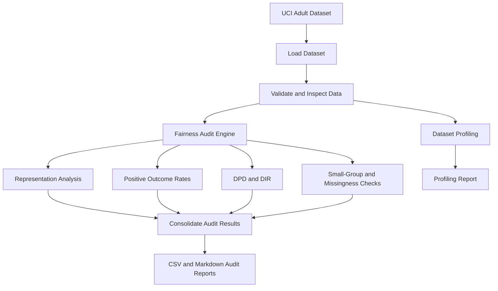
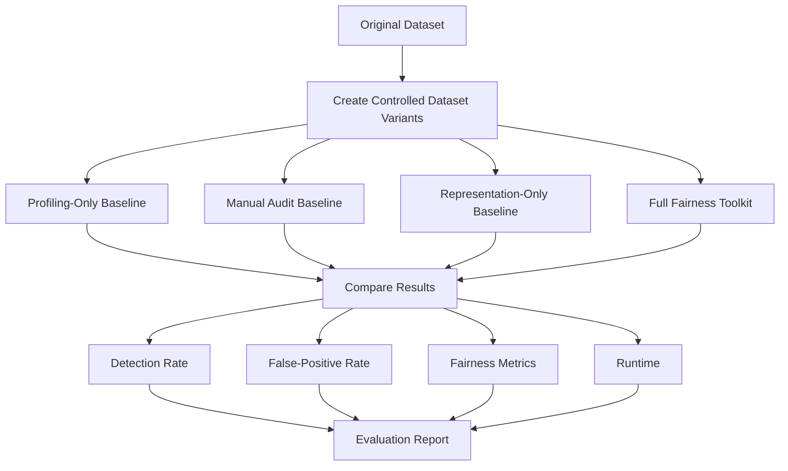

# System Architecture — Bias and Fairness Auditing Toolkit

## 1. Purpose

The Bias and Fairness Auditing Toolkit identifies potential fairness risks in machine-learning training datasets before model training.

It analyzes demographic representation, group-level positive outcome rates, demographic disparity metrics, small-group risks, and missing-data patterns. The toolkit produces reports to support further investigation.

Audit results are risk indicators; they do not independently prove discrimination or establish that a dataset is fair.

## 2. Initial Dataset

**Dataset:** UCI Adult Census Income Dataset

- Sensitive attributes: `sex`, `race`
- Target column: `income`
- Input format: Tabular dataset loaded into a pandas DataFrame

Future validation may include COMPAS and German Credit, after defining suitable sensitive attributes and outcome columns for each dataset.

## 3. System Architecture

## 4. Architecture Components

### 4.1 Dataset Input and Loading

The system accepts a tabular dataset and loads it into a pandas DataFrame.

For the initial experiment, the UCI Adult Income dataset is used.

### 4.2 Data Validation and Inspection

The input is inspected for missing values, required columns, valid target values, and data quality issues before the audit is performed.

### 4.3 Dataset Profiling

The profiling component summarizes dataset characteristics, distributions, correlations, and missing-data patterns.

The profiling report provides general data-quality information. It is not a substitute for fairness-specific checks.

### 4.4 Fairness Audit Engine

The audit engine evaluates potential fairness risks through the following checks:

- **Representation analysis:** Calculates group counts and percentages.
- **Positive outcome rates:** Measures the proportion of each group receiving the positive outcome.
- **Demographic Parity Difference (DPD):** Measures the gap between the highest and lowest group positive outcome rates.
- **Disparate Impact Ratio (DIR):** Compares the lowest group positive outcome rate with the highest.
- **Small-group warnings:** Highlights groups for which estimates may be less reliable.
- **Group-wise missingness:** Examines whether missing values differ across sensitive groups.

### 4.5 Report Generation

The system generates outputs such as profiling reports, CSV audit results, and a consolidated Markdown report.

The reports should explain detected risk signals and relevant limitations rather than make unsupported conclusions about discrimination.

## 5. Experimental Evaluation Architecture

A separate evaluation workflow compares four approaches using the same dataset variants.

Controlled dataset variants will include no-injection cases and cases with deliberately introduced outcome disparities. The injected changes will be recorded so that detection performance can be evaluated against known experimental conditions.

The evaluation workflow is a proposed design; experiments should only be described as completed after their actual results have been verified.

## 6. Baseline Approaches

| Baseline | Description |
|---|---|
| Profiling-only | Uses general-purpose dataset profiling without dedicated fairness analysis. |
| Manual audit | Uses manually calculated group counts and outcome rates. |
| Representation-only | Checks group representation and small-group risks. |
| Full toolkit | Combines representation, outcome disparity, DPD, DIR, and missingness checks. |

## 7. Evaluation Metrics

- **Detection rate:** Proportion of injected-bias test cases correctly flagged.
- **False-positive rate:** Proportion of no-injection control cases incorrectly flagged.
- **DPD:** Difference between the maximum and minimum group positive outcome rates.
- **DIR:** Ratio of the minimum to maximum group positive outcome rates.
- **Runtime:** Time taken by each approach to process a dataset.

Model-based fairness measures, such as equalized odds, may be added in a later stage if model predictions are incorporated into the evaluation.

## 8. Future Extensions

Potential extensions include:

- Synthetic-bias injection and systematic detection experiments.
- Proxy-feature risk analysis.
- Confidence intervals and uncertainty estimation.
- Validation on COMPAS and German Credit.
- Optional model-based fairness evaluation.
- Severity-ranked HTML or PDF reports.

## 9. Limitations

- Dataset-level fairness metrics do not establish the fairness of a trained model.
- Outcome disparities alone do not explain their causes.
- Small groups may produce unstable estimates.
- Missing-data differences require contextual investigation.
- Results depend on attribute definitions, thresholds, and dataset context.

The toolkit should be treated as an auditing aid that identifies risks for further investigation, not as an automated verdict on whether a dataset is fair.
